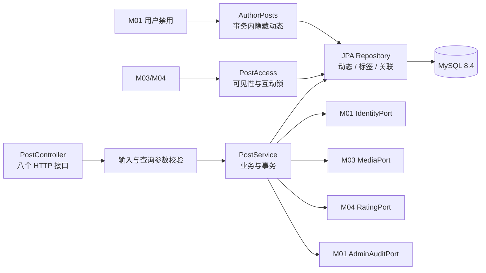
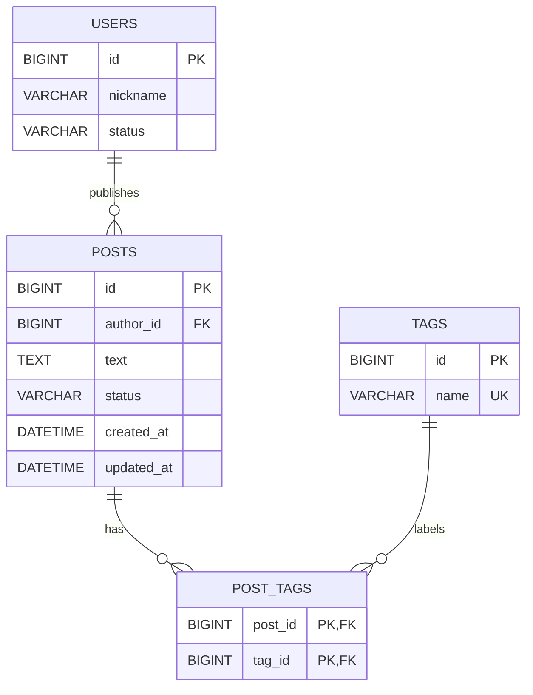
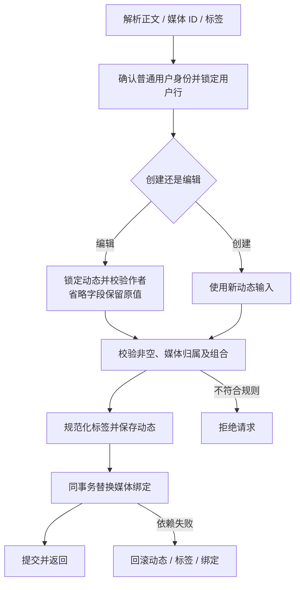

# M02 动态、标签与检索模块设计与实现说明

负责人：锡汉唐。本文作为实验报告与 PPT 的个人素材，记录 2026-11-18 开发的 M02 模块。整体系统尚待其他成员服务与前端接入。

## 1. 需求与职责

本模块对应 U02 多媒体动态发布、U03 本人内容管理、U04 日期与标签检索、A02 管理员内容管理。负责动态本身的业务规则、可见性、作者权限和查询；媒体字节读写、JWT 认证、评分计算由其他模块提供。

## 2. 模块结构

`PostAccess` 不依赖媒体和评分服务，因此其他成员可以调用动态状态检查而不产生服务循环依赖。完整端口签名与事务约定见 [实施与交接约定](../specs/contracts/posts-module.md)。

## 3. 实际维护的数据库结构

M02 的候选 SQL 实际创建 `posts`、`tags`、`post_tags`。图中 USERS 只是 M01 表的只读依赖，本模块不创建正式用户表。媒体、评分、评论和日志的全组关系草案仍以 [数据模型约定](../specs/contracts/data-model.md) 为准，需各负责人按实际迁移校对后形成最终全组 ER 图。

索引包括动态时间与 ID、作者与时间、状态与时间，以及标签到动态的反向索引。标签名唯一，动态与标签采用复合主键；外键保证作者及关联记录存在。时间以 UTC DATETIME(6) 保存。

## 4. 发布与编辑

PATCH 支持部分更新；省略字段保留，空数组清空对应关联。显式 null、未知字段和空 PATCH 对象拒绝。媒体只允许纯文字、1–9 张图片或 1 个视频；文字可与一种媒体同时存在。编辑保留创建时间，更新时间单独更新。

## 5. 检索与分页

- 日期按北京时间自然日转换为 UTC 半开区间，避免遗漏结束日最后一秒之后的微秒记录。
- 日期、单标签及后台作者/关键词条件取交集；关键词中的 `%`、`_`、`!` 按字面值匹配。
- 所有读取都限定 ACTIVE 动态和 ACTIVE 作者，软删除或禁用用户不会继续出现在查询结果中。
- 排序固定为 `created_at DESC, id DESC`，同一时刻的多条记录仍有确定顺序。保证静态数据下分页稳定；翻页期间有新增/删除时，偏移分页不承诺固定快照。
- 列表一次批量查询作者、标签、媒体和评分摘要，避免为每条动态逐个请求依赖服务。

## 6. 删除与权限

作者只能编辑或删除本人内容；管理员通过管理接口查询和删除动态，不能借普通用户接口发布内容。管理员删除与管理日志共享事务，日志失败时回滚删除。用户禁用由 M01 统筹，本模块只提供加入调用方事务的隐藏方法。

媒体访问、评论/评分提交仍需 M03/M04 在真实服务中调用 PostAccess；这些跨模块入口的真实行为须在 S4 联调确认。

## 7. 验证与展示材料

自动化用例覆盖输入边界、数据库约束、作者/管理员权限、媒体绑定失败回滚、自然日边界、标签交集、分页排序、批量摘要、软删除、禁用事务和并发创建标签。证据、实际用例数量和未完成范围见 [测试证据目录](../tests/evidence/M02/README.md)。

可讲解顺序：纯文本发布与标签规范化 → 日期加标签筛选 → 部分编辑与作者校验 → 逻辑删除 → 管理日志失败回滚 → ER 图与索引设计。真实登录、媒体文件与前端截图应由联调后录制，不以测试夹具充当已上线功能。

## 8. 待协作完成

- M01：主工程、JWT/身份适配、用户表正式迁移、管理日志、禁用总事务与迁移编号。
- M03：真实媒体锁定、绑定/解除绑定、文件读取与失效检查。
- M04：批量评分摘要、删除/禁用后的互动控制。
- M06/M07/M08：实际页面调用八个接口并交叉验收。
- 收到老师正式附件模板后，与 M06 共同填写附件 2 的实际栏目。
