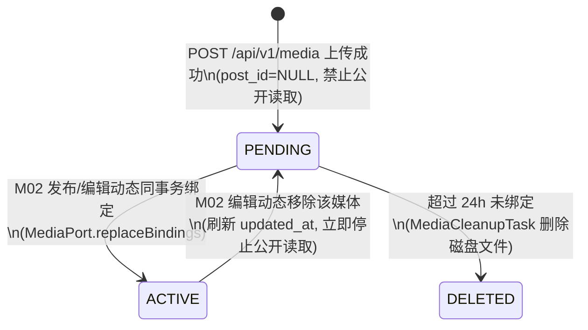

# M03 媒体文件服务与运行环境设计与实现说明

负责人：潘铭伟（M03）。本文作为实验报告、附件 3（与 M07 协同）及课堂展示 PPT 的个人素材，记录 `src/backend/modules/media/`、`src/.env.example` 与 `src/README.md` 的实际设计与实现。

## 1. 需求与职责边界

本模块对应需求 **U02（图片/视频上传与展示）**、**U03（编辑替换与删除时媒体状态同步）** 与 **N01（统一运行环境与启动说明）**，负责：
1. 媒体文件的上传校验（JPEG/PNG/WebP ≤ 10 MB、MP4 ≤ 50 MB，MIME 与二进制魔数双重检查）、本地安全存储（`yyyy/MM/dd/{uuid}.{ext}`）及异常清理。
2. 已发布媒体的公开读取与 MP4 视频 **HTTP Range（RFC 9110 `206 Partial Content` / `416`）** 分段流式响应。
3. 实现 M02 定义的 `MediaPort`（`lockAndInspect`、`replaceBindings`、`findByPostIds`），并调用 M02 `PostAccess.requireVisible` 防止未发布、已删除动态或禁用作者的媒体泄露。
4. 定时清理超过 24 小时未绑定（含上传后未绑定及编辑移除解绑后超时）的 `PENDING` 媒体文件与记录。
5. 维护三端统一环境变量样例 [`src/.env.example`](../src/.env.example) 与整体启动说明 [`src/README.md`](../src/README.md)。

## 2. 模块结构与跨模块协作

```mermaid
flowchart LR
    C[MediaController\nPOST /media & GET /media/id/content] --> I[MediaInspector\nMIME + MagicBytes + 大小校验]
    C --> R[RangeParser\nRFC 9110 Range 解析]
    C --> S[MediaService\n上传/读取/清理 & MediaPort实现]
    S --> ST[MediaStorage\nyyyy/MM/dd/uuid.ext & 防穿越]
    S --> DB[(media 表)]
    S --> PA[M02 PostAccess\n动态与作者可见性检查]
    P[M02 PostService] -->|同一事务| S
    T[MediaCleanupTask\n@Scheduled 定时清理] --> S
```

## 3. 媒体表结构与状态机

`media` 表候选迁移位于 [`src/backend/modules/media/src/main/resources/db/migration-candidates/m03/media.sql`](../src/backend/modules/media/src/main/resources/db/migration-candidates/m03/media.sql)：



## 4. 安全与一致性保障

1. **禁止使用原始文件名作为存储键**：客户端文件名经清洗仅存入 `original_name` 作展示元数据，磁盘路径固定由服务端按 UTC 日期与 UUID 生成，并通过 `Path.normalize().startsWith(rootDir)` 阻断路径穿越。
2. **文件流与数据库事务原子一致**：磁盘写入异常直接删除半成品文件；数据库事务回滚时通过 `TransactionSynchronization.afterCompletion` 自动删除已落盘物理文件，杜绝孤儿文件。
3. **跨模块并发与权限隔离**：`MediaPort` 写操作强制 `Propagation.MANDATORY` 加入 M02 动态事务，按 `media.id ASC` 悲观写锁防死锁，并严格校验 `uploaded_by == actorId` 与 `post_id` 唯一归属。

## 5. 测试验证与运行说明

- **模块与跨模块联调测试**：共 25 项 JUnit 5 + MockMvc 自动化测试（17 项输入/魔数/Range 单元测试 + 8 项 M02+M03 跨模块集成测试）全部通过，详见 [M03 测试证据](../tests/evidence/M03/README.md)。
- **三端运行说明与环境变量**：已整理至 [`src/README.md`](../src/README.md) 与 [`src/.env.example`](../src/.env.example)，所有示例密码与密钥均使用占位符。

## 6. 待协作完成

- **M01**：合入主工程时引入 `media-module` 依赖与 `MediaModuleConfiguration`，在 Flyway 中分配正式 `V序号__media.sql`，并提供真实 `IdentityPort`（JWT）。
- **M06 / M07**：在微信小程序发布页接入 `POST /api/v1/media`，在详情页使用 `<video>` 测试 `GET /api/v1/media/{mediaId}/content` 的拖动播放。
- **M07 / M08**：协同 M07 完成正式附件 3（收到老师模板后），并配合 M08 汇总全组实验报告。
