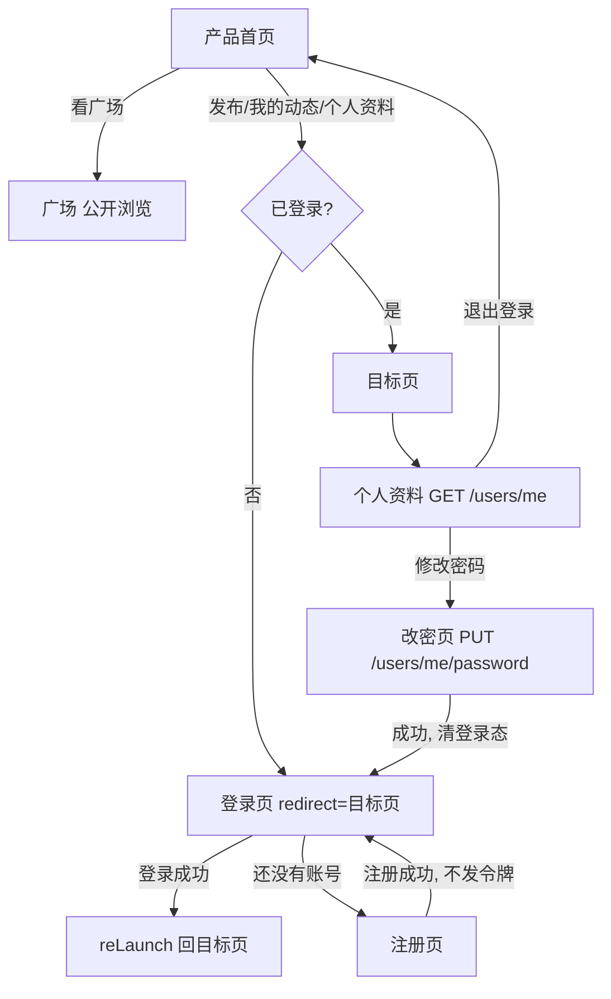
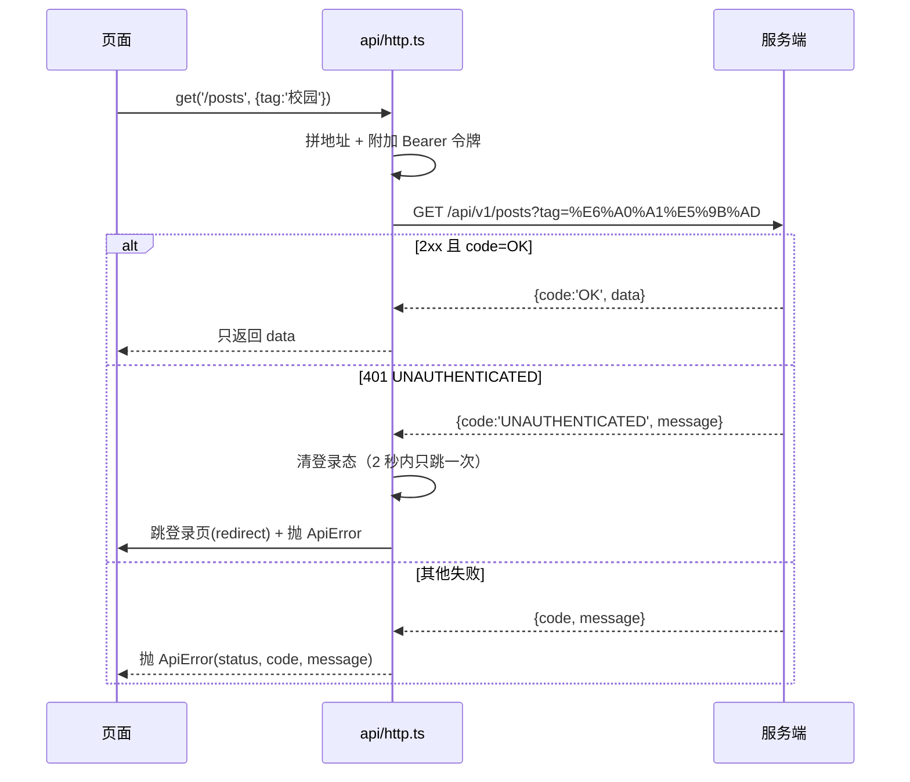

# M05 小程序公共层与账号模块实施说明

负责人：成员 05。本文作为实验报告、附件 1（与 M01 协同）及课堂展示 PPT 的个人素材，记录 `src/miniapp/` 的工程组织、设计令牌、公共组件、账号流程、请求层与登录态，以及为 M06/M07 预留的接口层。

> 证据边界：本文描述的设计与代码均已提交并有自动化测试（117 项）；**真实服务端联调与微信开发者工具内的人工验收尚未完成**，报告中不得写成"已完成联调"。

## 1. 需求与职责边界

对应需求 **U01（用户登录与设置密码）** 与 **N01（统一交互与运行环境）**，总任务 T01、T03、T08、T09。

负责：

1. 小程序工程（uni-app + Vue 3 + TypeScript + Vite 5）与构建脚本，保证三名小程序成员能在同一工程并行开发。
2. 设计令牌（颜色、字号、间距、圆角、阴影）与公共组件（按钮、输入项、页面状态、占位页），统一三个成员的界面。
3. 注册、登录、个人资料、修改密码四个页面及其校验、加载态、错误提示。
4. 统一请求层（地址拼接、令牌、响应解析、错误归一、401 清理与回跳）、登录态存储与登录守卫。
5. 按 `specs/contracts/api.md` 预留 auth / posts / media / interactions 四个接口模块与全部出入参类型，供 M06/M07 直接调用。

不负责：广场与详情页面（M07）、发布与我的动态页面（M06）、服务端接口实现（M01–M04）。

## 2. 工程与目录结构

```text
src/miniapp/
├── package.json            # 脚本：dev/build:mp-weixin/type-check/test
├── vite.config.ts          # uni 插件
├── vitest.config.ts        # 单测 + jsdom 组件测试，强制 MOCK=false
├── src/
│   ├── pages.json          # 10 个页面注册（与 config/routes.ts 一一对应）
│   ├── manifest.json       # 小程序 appid（当前为空，构建回退 touristappid）
│   ├── uni.scss            # 设计令牌与 mixin（自动注入每个页面）
│   ├── styles/base.scss    # 全局工具类
│   ├── config/             # env.ts（地址、mock 开关）、routes.ts（路由表）
│   ├── api/                # http.ts、types.ts、auth/posts/media/interactions、mock.ts
│   ├── stores/auth.ts      # 登录态
│   ├── utils/              # validate.ts、feedback.ts、navigate.ts
│   ├── components/         # AppButton、FormField、StateView、PlaceholderPage
│   └── pages/              # home（产品首页）、login、register、profile、password、devkit
└── tests/                  # 117 项（12 个文件）
```

设计取舍见 [决策 0004](../specs/decisions/0004-m05-miniapp-engineering-and-shared-layer.md)：用 CLI 工程保证构建与测试可脚本化、可留证据；登录态用轻量 `reactive` store 而非 Pinia；设计令牌用 `uni.scss` 依赖 uni-app 的自动注入。

## 3. 设计令牌与公共组件

令牌只允许通过变量引用，禁止页面写死颜色与间距（否则三人界面会漂移）：

| 类别 | 取值示例 |
| --- | --- |
| 品牌色 | `$brand-primary #2F6FEB`，浅底 `#EAF1FE` |
| 语义色 | 成功 `#12A150`、警示 `#E08A00`、危险 `#E5484D` |
| 文字 | 主 `#1D2129`、次 `#4E5969`、辅助 `#86909C`、占位 `#C0C4CC` |
| 背景/描边 | 页面 `#F4F5F7`、卡片 `#FFFFFF`、描边 `#E5E6EB` |
| 字号 | 22 / 28 / 32 / 36 / 44 rpx 五档 |
| 间距 | 8 / 16 / 24 / 32 / 48 rpx 阶梯 |
| 圆角 | 8 / 16 / 24 / 999 rpx |

| 组件 | 关键能力 | 为什么需要 |
| --- | --- | --- |
| `AppButton` | 四种类型、`loading`、默认 400ms 节流、加载/禁用期间不派发点击 | 防重复提交是最容易漏的公共能力，集中实现并测试 |
| `FormField` | 标签、必填标记、错误提示（优先于 hint）、密码显隐、清空、禁用 | 四个账号页表单结构与错误展示一致 |
| `StateView` | 加载 / 空 / 错误 / 正常四态，错误态必带重试 | 避免"请求失败后停在空白页" |
| `PlaceholderPage` | 未实现页面的统一占位，标注负责人与待办 | M06/M07 未完成时工程仍可构建、可跳转 |

## 4. 账号流程



页面与路由参数见 [实施约定](../specs/contracts/miniapp-module.md) 第 6 节。关键约定：

- 公开页面（广场、详情、评论）**不调用**登录守卫；受保护入口调用 `requireLogin(目标路径)`，把目标页作为 `redirect`。
- `redirect` 只接受 `/pages/<目录>/<页面>` 形式，外链、`//` 开头、锚点一律拒绝（`isSafeInternalPath`）。
- 登录成功用 `reLaunch` 回原页，清空页面栈，避免登录页残留在返回路径。
- 改密成功立即 `clear()` 并回登录页，强制用新密码重登（对应旧令牌失效）。

## 5. 请求层与登录态



- 失败统一抛 `ApiError { status, code, message }`，`message` 优先用服务端文案，缺失按状态码兜底，页面可直接 `toastError`。
- 网络异常归一为 `status 0 / NETWORK_ERROR`；默认超时 15s，上传 60s。
- 登录/注册自身的 401 不触发清理与跳转（那是账号密码错误）；未登录时的 401 只清理状态，不打断公开浏览。
- 登录态缓存键 `moments.auth.v1`，令牌 12 小时；`expiresAt` 为空或无法解析时按未过期处理，以服务端 401 为准。

## 6. 留给 M06/M07 的接口层

| 模块 | 函数 | 端点 |
| --- | --- | --- |
| `api/posts.ts` | `listPosts` `getPost` `createPost` `updatePost` `deletePost` `listMyPosts` | 动态列表/详情/增删改、本人列表 |
| `api/media.ts` | `uploadMedia` `mediaDisplayUrl` `mediaContentUrl` | 上传、媒体内容地址 |
| `api/interactions.ts` | `ratePost` `listComments` `createComment` | 评分、评论 |
| `api/auth.ts` | `register` `login` `fetchMe` `changePassword` | 账号（M05 使用） |

配套 `api/mock.ts`：`VITE_MINIAPP_USE_MOCK=true` 时命中本地样例（账号 demo/admin、3 条动态、评论、评分、上传），服务端未就绪也能调页面；关闭开关即走真实服务端，业务代码不变。模拟数据**不能作为联调证据**，媒体地址无真实文件、页面需做加载失败占位。

## 7. 测试结论

- **117 项** Vitest 用例全部通过（0 失败 / 0 跳过）：请求层 13、登录态 10、登录守卫 12、表单校验 12、路由一致性 12、接口路径 4、契约常量 8、地址拼接 9、模拟接口 11，以及公共组件 26（`AppButton` 7、`FormField` 11、`StateView` 8）。
- `vue-tsc --noEmit` 退出码 0；`build:mp-weixin` 与 `build:h5` 退出码 0，产物注册 10 个页面。
- 证据：[S3 验证日志](../tests/evidence/M05/2026-11-26-s3-verify.log)、[JUnit XML](../tests/evidence/M05/junit-results-s3.xml)、[用例与结论](../tests/evidence/M05/README.md)。

尚未执行：微信开发者工具内的账号界面用例（见 [手工用例清单](../tests/evidence/M05/手工用例清单.md)）、真实接口联调、真机预览。

## 8. 已知限制与待办

1. 真实服务端未联调：账号接口由 M01 实现，目前只有契约、类型与模拟数据。
2. 微信开发者工具内的人工验收与截图未补；工程曾被组员手动导入并成功编译（工具日志可证，见证据文档）。
3. `manifest.json` 的 `mp-weixin.appid` 为空，构建回退 `touristappid`；CLI 导入会被拒，无 AppID 模式只能在图形界面选择。
4. 待 M01 确认：改密字段名（Q1）、账号/密码规则（Q2）、登录返回是否含 `role`（Q3）、注册是否发令牌（Q4）。
5. 待实测：小程序 `wx.request` 对 `PATCH` 的支持（Q7）——契约的编辑接口是 `PATCH /posts/{postId}`，若不支持需改 `POST` + `X-HTTP-Method-Override`。
6. 未加 tabBar（Q6），广场入口确定后再统一加。

## 9. 汇报要点（PPT）

1. **公共层如何避免三人冲突**：公共文件（`pages.json`、`uni.scss`、`api/`、`utils/`）由 M05 单点维护，页面目录按成员划分，M06/M07 只写自己的页面。
2. **路由双重登记 + 单测**：`routes.ts` 与 `pages.json` 必须一致，不一致测试直接失败，避免"跳转失败"这类联调期才发现的低级问题。
3. **登录态与回跳链路**：令牌过期 → 受保护操作 → 401 → 清状态 → 登录 → 回到刚才的位置，可现场演示。
4. **令牌化界面**：颜色/字号/间距全部走变量，三个成员的页面风格自动一致。
