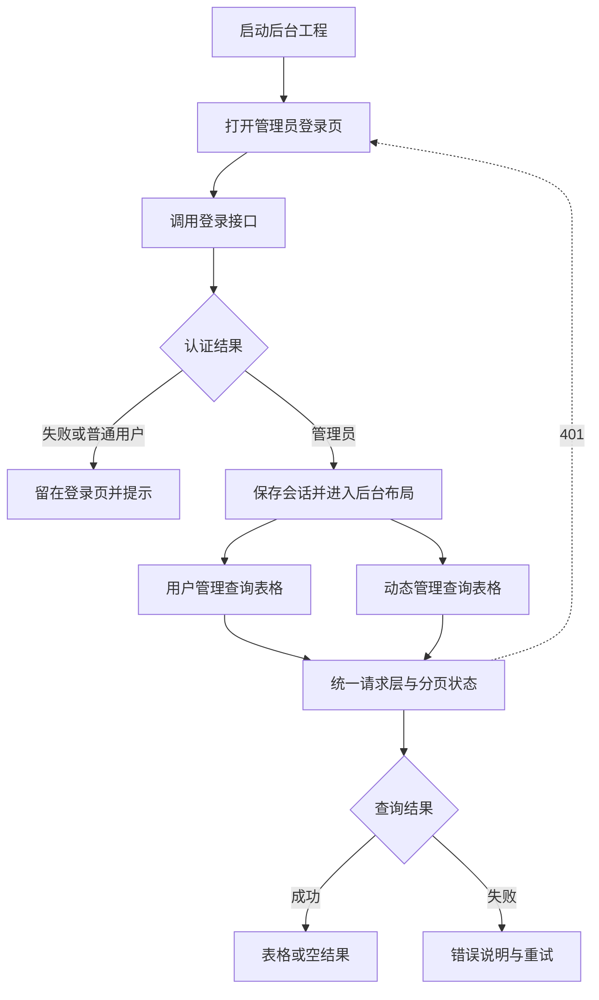

# 软件工程大作业 M08 第一周后台实施方案

> 项目：多媒体朋友圈展示系统 · 负责人：叶天豪（M08）
> 文档日期：2026 年 11 月 25 日 · 版本：v0.1
> 源码基线：`main` / `8c399d44894e3bd922657f244b31ae1a1237513c`（2026-11-25）
> 周次：第一周，截图可确认从 2026-11-20 开始，结束日期被裁切，暂不补写。
> 状态：保留的原始第一周实施方案；方案编写时尚未写入源码、未运行验证。现有后端调用链已按上述提交核对，当前实施结果见下方更新。

> 实施更新（2026-11-25）：第一周前端现已落地，本文保留原始方案供对照。实际文件与调用链见 [第一周实现说明](../deliverables/M08_第一周后台实现说明.md)；启动配置见 [后台 README](../src/admin-web/README.md)。当前使用 `/api/v1` 与 Vite 代理；真实登录、本人信息及普通用户拒绝已验证，管理列表仍待接入，见 [联调记录](../tests/evidence/M08/integration/README.md)。

本周工作是在 `src/admin-web/` 建立可以独立启动的管理后台，完成管理员登录、后台路由布局，以及用户和动态的基础查询表格。页面需要按照项目 API 契约显示分页、加载、空结果和错误状态。第一周任务以本次分工截图为准，覆盖仓库 M08-S1 和 M08-S2 的登录、查询部分。交付时应有可运行工程、运行说明和实际自测记录。

## 1. 怎么做



**主线：**建立工程 → 对齐接口 → 验证管理员身份 → 展示后台布局 → 按条件查询与分页 → 保存自测证据。

- **本周产出：**Vue 3、TypeScript、Vite、Element Plus 工程；登录页；用户管理页；动态管理页；统一请求、认证状态和路由守卫；工程启动说明。
- **页面与数据：**以 API 返回的 `items`、`page`、`pageSize`、`total` 驱动表格，分页从 1 开始，默认每页 10 条、最大 50 条。查询条件改变时回到第一页。
- **身份与权限：**用户和管理员共用登录接口。后台只接受 `ADMIN`，刷新页面后通过 `/users/me` 复核身份；服务端仍须验证 JWT、用户状态和权限。
- **失败反馈：**区分参数错误、未登录、无权限、网络或服务异常。首次加载失败显示错误与重试，刷新失败保留上次数据并标明未更新，成功返回零条才显示空结果。
- **阶段边界：**后续再实现用户删除或禁用、动态删除、媒体预览、改密页面、完整跨端联调与全员报告合并。本周不把样例数据演示计为真实服务验收。

### 当前仓库与任务依据

| 对象 | 已核实状态 | 对第一周工作的影响 |
| --- | --- | --- |
| `src/admin-web/` | 仅有 `.gitkeep`，尚无 `package.json` 或页面代码 | 从工程骨架、请求层和页面入口开始建设 |
| 登录与用户管理 | `specs/contracts/api.md` 已列端点与通用响应；当前没有 M01 主工程实现 | 登录和用户列表按契约设计，完整字段样例需与 M01 对齐 |
| 动态管理查询 | M02 已实现 `GET /api/v1/admin/posts`、参数解析与管理员角色检查 | 前端参数可直接对齐现有代码；真实 JWT 及主工程接入仍待联调 |
| 媒体与评分依赖 | 动态视图通过 `MediaPort`、`RatingPort` 读取关联内容 | 查询失败须如实显示，不能在真实 API 模式下自动切换为假数据 |
| M08 原始任务 | 包含五阶段任务和全周期职责 | 本周完成工程、登录、基础查询；其他阶段按后续进度推进 |

依据：[个人任务](https://github.com/Frident114514/exp_5/blob/8c399d44894e3bd922657f244b31ae1a1237513c/%E6%88%90%E5%91%98%E4%BB%BB%E5%8A%A1/08_Web%E5%90%8E%E5%8F%B0%E4%B8%8E%E4%BA%A4%E4%BB%98%E6%B1%87%E6%80%BB.md#L40)、[API 契约](https://github.com/Frident114514/exp_5/blob/8c399d44894e3bd922657f244b31ae1a1237513c/specs/contracts/api.md#L7)、[动态模块接入约定](https://github.com/Frident114514/exp_5/blob/8c399d44894e3bd922657f244b31ae1a1237513c/specs/contracts/posts-module.md#L7)。M02、M03 的已有模块测试属于相应成员的成果，不能作为 M08 后台已通过验收的证据。

### 工程结构与运行方式

前端使用 Vue 3 单文件组件和 TypeScript；Vue Router 管理页面与权限入口，Element Plus 提供表单、菜单、表格、分页和反馈组件。第一周用一个认证 composable 管理会话，用浏览器 `fetch` 封装请求，减少额外依赖。依赖的实际版本在建工程时写入 `package.json` 并通过 `package-lock.json` 固定，后续复现使用 `npm ci`。

```text
src/admin-web/                         [以下文件均拟新增]
├── package.json / package-lock.json   依赖及 npm 脚本
├── index.html / vite.config.ts        页面入口及 Vite 配置
├── tsconfig*.json / .env.example      类型与本地服务配置
├── .gitignore                        忽略依赖、构建产物及本地环境配置
├── README.md                         安装、启动、构建及联调说明
└── src/
    ├── main.ts / App.vue              挂载应用与顶层路由出口
    ├── router/index.ts                路由、守卫及默认跳转
    ├── composables/useAuth.ts          认证状态与会话恢复
    ├── composables/usePagedQuery.ts    表格查询和请求状态
    ├── api/http.ts                    统一请求与错误归一化
    ├── api/auth.ts                    登录及本人信息 API
    ├── api/adminUsers.ts              用户查询 API
    ├── api/adminPosts.ts              动态查询 API
    ├── types/api.ts                   响应、分页及对象类型
    ├── layouts/AdminLayout.vue        左侧导航及顶部账号栏
    ├── views/LoginView.vue            管理员登录
    ├── views/UsersView.vue            用户查询表格
    ├── views/PostsView.vue            动态查询表格
    ├── views/ForbiddenView.vue        无权限提示
    ├── views/NotFoundView.vue         路由不存在提示
    └── styles/main.css                全局布局与间距
```

浏览器配置写在 `src/admin-web/.env.local`，样例保存在该工程的 `.env.example`。沿用 [M03 提供的变量名](https://github.com/Frident114514/exp_5/blob/8c399d44894e3bd922657f244b31ae1a1237513c/src/.env.example#L39)：`VITE_ADMIN_API_BASE_URL=http://127.0.0.1:8080/api/v1`、`VITE_ADMIN_DEV_PORT=5173`。仓库 `src/.env.example` 是统一配置样例，后台工程应显式读取自己的配置文件。Vite 端口设置为 `strictPort: true`，占用时直接提示调整，确保运行说明中的地址准确。

运行环境选用 Node.js 22，具体版本需满足所选 Vite 的要求。官方指南当前列出的最低范围为 Node.js 20.19+ 或 22.12+；本工程拟要求 Node.js 22.12+。本次命令检查发现，当前环境 `node -v` 为 `v12.22.12`，低于要求，建工程前需先配置合适的 Node.js。首次安装和后续复现命令如下，均须在工程落地后执行：

```sh
cd src/admin-web
npm install                 # 首次建立并固定锁文件
# 已有 package-lock.json 的环境使用 npm ci
npm run dev                 # 开发地址 http://127.0.0.1:5173
npm run typecheck           # 拟配置为 vue-tsc --noEmit
npm run build               # 拟配置为类型检查后执行 vite build
npm run preview             # 本地查看构建产物
```

后台使用 history 路由；部署说明需要写明将前端路由回退至 `index.html`。开发时 API 地址与前端地址不同，需与 M01 对齐允许 `http://127.0.0.1:5173` 的 CORS 配置。服务端 JWT 密钥和数据库密码不进入前端环境变量。工程 `.gitignore` 应忽略 `node_modules/`、`dist/` 和 `.env*`，仅保留 `.env.example`，当前仓库根忽略规则尚未覆盖这些目录。

### 页面与路由

| 路由 | 页面与布局 | 访问条件及基础交互 |
| --- | --- | --- |
| `/login` | 账号、密码、登录按钮和错误说明 | 公开；校验必填；提交期间显示 loading 并阻止重复提交 |
| `/` | 后台默认入口 | 通过守卫后重定向至 `/users` |
| `/users` | 用户管理，搜索栏、查询结果及分页 | 已验证管理员；支持关键词、重置和分页 |
| `/posts` | 动态管理，组合筛选栏、查询结果及分页 | 已验证管理员；支持正文关键词、作者 ID、日期和单标签 |
| `/403` | 无权限说明及返回登录入口 | 公开；不得挂载后台查询组件 |
| 其他路径 | 404 提示 | 公开；提供返回登录或有效后台页面的入口 |

`AdminLayout` 使用左侧“用户管理 / 动态管理”菜单，顶部显示管理员昵称及退出入口，主体放置子路由。两个列表保持相同的搜索按钮、表格间距、错误栏和分页位置；浏览器宽度较小时允许表格横向滚动。表格以 `id` 作为行标识，动态正文使用文本渲染并截断展示，完整内容留待详情阶段。

### 接口与展示字段

基础地址已含 `/api/v1`，请求层只拼接下表的相对路径，避免重复基础路径。

| 业务 | 方法与相对路径 | 请求内容 | 本周所需返回 |
| --- | --- | --- | --- |
| 登录 | `POST /auth/login` | `{ account, password }` | `accessToken`、`expiresAt`、`user` |
| 恢复会话 | `GET /users/me` | Bearer 令牌 | 管理员本人资料及角色 |
| 用户查询 | `GET /admin/users` | 拟定 `keyword`、`page`、`pageSize` | `PageData<UserSummary>`，字段需 M01 确认 |
| 动态查询 | `GET /admin/posts` | `keyword`、`authorId`、`from`、`to`、`tag`、`page`、`pageSize` | 已有 `PageView<PostView>` |

通用响应为 `{ code, data, message }`，只有 HTTP 成功且 `code === "OK"` 才按成功处理；受保护请求携带 `Authorization: Bearer <accessToken>`。`items` 为当前页数据，`total` 为符合条件的记录总数，不能用本页长度代替。

登录与用户查询端点已有约定，但 `user` 完整形状、`/users/me` 允许管理员访问、`expiresAt` 序列化格式，以及用户查询关键词匹配范围尚缺完整样例。以下为前端拟定字段，须与 M01 对齐后落实，不构成对公共契约的修改：

| 对象 | 拟定或已核实字段 | 页面用途与状态 |
| --- | --- | --- |
| `UserSummary` | `id`、`account`、`nickname`、`role`、`status`、`createdAt` | 用户 ID、账号、昵称、角色、状态、注册时间；拟定，依据数据模型，不返回密码哈希或令牌版本 |
| `LoginData` | `accessToken`、`expiresAt`、`user` | 名称来自 API 契约；拟将 `expiresAt` 定为带时区 ISO 字符串，`user` 使用上述基本资料 |
| `PostView` | `id`、`author.{id,nickname}`、`text`、`media`、`tags`、`createdAt`、`updatedAt`、`rating` | 已核实 M02 类型；本周显示 ID、作者、正文摘要、标签、媒体数量和发布时间 |

动态后台列表只返回有效动态和有效作者，因此不从本次响应臆造 `status` 列。用户状态拟显示 `ACTIVE → 正常`、`DISABLED → 已禁用`，未知枚举显示原值并保留说明。时间统一显示为北京时间，筛选日期直接发送 `YYYY-MM-DD`，不先转换成 UTC 日期。

动态筛选的确切规则来自现有代码：`authorId` 为正整数，`keyword` 最多 100 个 Unicode 码点，`tag` 最多 20 个；关键词搜索正文的字面包含，`%`、`_` 不作为通配符；日期起止包含北京时间自然日；多个条件取交集；按 `createdAt DESC, id DESC` 排序。标签输入框每次只传一个标签，当前不依赖未约定的标签列表接口。

对接安排：M01 确认登录、本人信息和用户分页样例，确保普通用户、禁用用户及失效令牌被服务端拒绝；M02 确认动态参数及真实联调地址；M03 核对后台运行配置；M04 对齐本周验收编号及证据格式。这里列出的是待对接事项，尚无成员确认记录。

### 本周执行顺序与验收记录

| 顺序 | 实施内容 | 完成时应具备的证据 |
| --- | --- | --- |
| 1 | 建立工程、依赖、npm 脚本、布局及路由 | 干净环境安装和启动记录；登录页及布局截图 |
| 2 | 固定请求与对象类型，完成认证和路由守卫 | 管理员、普通用户、错误密码、过期会话的实际结果 |
| 3 | 完成用户表格与动态表格，接入查询和分页 | 查询参数及返回页一致；组合筛选结果可核对 |
| 4 | 补齐加载、空结果、错误和重试，执行自测 | 状态截图、类型检查和构建日志 |
| 5 | 整理运行说明并登记进度 | M08 个人记录、修改文件清单及联调缺项 |

证据拟存入 `tests/evidence/M08/week1/`，记录环境、步骤、预期、实际结果和对应截图。以下表格保留**方案编写时的待执行状态**；当前前端验证结果及真实联调缺项见 [第一周验证记录](../tests/evidence/M08/week1/README.md)。

| 编号 | 操作 | 预期结果 | 当前结果 |
| --- | --- | --- | --- |
| W1-01 | 安装依赖，执行 dev、typecheck、build | 工程启动，类型检查与构建成功 | 未执行 |
| W1-02 | 管理员正确密码登录，随后退出 | 显示后台两类导航；退出后受保护路由返回登录 | 未执行 |
| W1-03 | 普通用户登录、错误密码登录 | 分别提示无后台权限或认证失败；不进入后台 | 未执行 |
| W1-04 | 直接打开 `/users`、刷新 `/posts`、使用过期令牌 | 未登录重定向；有效管理员恢复页面；失效凭证重新登录 | 未执行 |
| W1-05 | 用户关键词查询、翻页、改变每页条数、重置 | 条件与请求一致；改变条件和每页条数回第一页 | 未执行 |
| W1-06 | 动态组合筛选，同日起止日期及倒置日期 | 有效条件取交集；包含自然日边界；倒置日期不发请求 | 未执行 |
| W1-07 | 请求延迟、零条结果、断网、500、401、403 | 分别显示加载、空结果、可重试错误、重新登录、无权限 | 未执行 |
| W1-08 | 快速连续查询，让前一次请求后返回 | 页面只呈现最后一次查询的结果，分页与条件一致 | 未执行 |
| W1-09 | 使用普通用户或失效令牌直接调用管理 API | 服务端实际拒绝，HTTP 状态与契约一致 | 待真实服务联调 |

后端依赖未就绪时，可用符合契约的虚构样例开展界面开发，样例与真实 API 模式需显式选择并在界面标明“样例演示”。真实请求失败不自动返回样例。W1-09 和真实管理员登录等用例必须接入 M01 服务后执行，未执行项保留原因，不能据样例演示关闭真实联调验收。

## 2. 函数调用链

以下前端函数名用于落实方案，均标注 `[拟新增]`；未给新文件编造行号。现有后端节点标注 `[已有]`，源码位置对应文档头的提交。跨 HTTP 的箭头表示请求交接，响应返回后另列页面更新步骤。

### 2.1 启动后台工程 → 显示登录页或管理布局

拟新增入口：`src/admin-web/src/main.ts`、`src/admin-web/src/router/index.ts`、`src/admin-web/src/layouts/AdminLayout.vue`。

```text
npm run dev [拟新增脚本]
→ Vite 读取 vite.config.ts 与后台工程环境变量
→ 浏览器加载 index.html、main.ts [拟新增]
  → createApp(App) [拟新增调用]
  → app.use(ElementPlus) [拟新增调用]
  → app.use(router) [拟新增调用]
  → app.mount('#app') [拟新增调用]

路由导航触发 router.beforeEach(to) [拟新增注册]
→ evaluateAdminAccess(to) [拟新增]
  ├─ 公开路由：允许显示登录、403 或 404 页面
  ├─ 无会话或本地已过期：clearSession() → 重定向 /login
  └─ 有会话：调用 ensureVerifiedSession() 复核身份
     ├─ 验证通过且 role=ADMIN：进入 AdminLayout 子页面
     ├─ 身份无效或 role≠ADMIN：清理会话并回登录 / 无权限页
     └─ 验证网络失败：阻止挂载后台，提示重试，不判为认证成功

默认后台路由 / → /users
→ AdminLayout 显示导航、账号栏及 RouterView [拟新增]
```

守卫应等待会话复核结束后再挂载列表组件，避免恢复身份期间提前发送管理查询。导航结果使用 Vue Router 返回值表达，避免多个跳转分支重复执行。

### 2.2 提交账号密码 → 管理员进入后台

现有依据：[登录响应约定](https://github.com/Frident114514/exp_5/blob/8c399d44894e3bd922657f244b31ae1a1237513c/specs/contracts/api.md#L13)、[登录端点](https://github.com/Frident114514/exp_5/blob/8c399d44894e3bd922657f244b31ae1a1237513c/specs/contracts/api.md#L21)。拟新增入口：`LoginView.vue`、`api/auth.ts`、`composables/useAuth.ts`；M01 登录内部函数链当前 `[待实现核实]`。

```text
用户点击登录或按回车
→ LoginView.handleLogin() [拟新增]
  ├─ 已在提交：忽略重复触发
  └─ form.validate() 通过：设置 submitting=true
     → authApi.login({ account, password }) [拟新增]
       → http.request('POST', '/auth/login', body) [拟新增]
         → HTTP 交接：M01 登录接口 [契约已有，实现待核实]

响应返回 handleLogin()，核对 HTTP、code 与数据结构后：
├─ 认证失败 / 网络异常：显示可读原因，不建立会话
├─ role≠ADMIN：提示“当前账号无后台访问权限”，清除会话
└─ ADMIN 且令牌、有效期可用：
   → setSession(accessToken, expiresAt, user) [拟新增]
   → router.replace(有效且允许的内部 returnTo 或 '/users')
   → 受保护路由守卫检查后进入后台

finally：submitting=false；密码不写入持久存储
```

`returnTo` 只接受 `/users`、`/posts` 及其合法查询参数，避免把任意地址当作登录成功跳转目标。登录表单密码按输入发送，不擅自裁去首尾字符。

### 2.3 刷新页面或令牌失效 → 恢复会话或重新登录

现有依据：[本人信息端点](https://github.com/Frident114514/exp_5/blob/8c399d44894e3bd922657f244b31ae1a1237513c/specs/contracts/api.md#L22)、[令牌失效规则](https://github.com/Frident114514/exp_5/blob/8c399d44894e3bd922657f244b31ae1a1237513c/specs/contracts/api.md#L13)。拟新增：`useAuth.ts` 的会话方法及 `api/http.ts`。

```text
刷新浏览器 / 首次进入受保护路由
→ ensureVerifiedSession() [拟新增；复用同一次验证 Promise]
  → restoreSession() [拟新增；读取本标签页 sessionStorage]
    ├─ 无数据、格式损坏、有效期无法解析或本地已过期：clearSession()
    └─ 尚未过期：authApi.getMe() [拟新增]
       → http.request('GET', '/users/me') [拟新增]
         → 添加 Bearer 令牌 → HTTP 交接：M01 复核 JWT 与用户状态

本人信息响应返回 ensureVerifiedSession() 后：
├─ ADMIN 且账号有效：更新 user，标记本次会话已复核
├─ 401 / 403 / 非管理员：clearSession()，返回登录或无权限结果
└─ 网络 / 500：返回验证失败与重试入口，暂不开放管理页面

任意受保护 API 返回 401
→ http.request() 通知认证失效 [拟新增]
→ clearSession()，作废当前会话版本并取消在途查询
→ 路由统一跳转 /login，仅提示一次“登录已失效，请重新登录”

用户点击退出 → logout() [拟新增]
→ clearSession() → router.replace('/login')
```

不解析未经服务端验证的 JWT 内容来授予权限。当前契约没有退出端点，第一周退出仅清除当前浏览器会话；服务端令牌是否撤销由后续认证约定决定。403 不一律当作令牌过期，应保留无权限原因并阻止当前管理结果展示。

### 2.4 查询用户或翻页 → 更新用户表格

现有依据：[管理员用户端点](https://github.com/Frident114514/exp_5/blob/8c399d44894e3bd922657f244b31ae1a1237513c/specs/contracts/api.md#L35)、[用户数据模型](https://github.com/Frident114514/exp_5/blob/8c399d44894e3bd922657f244b31ae1a1237513c/specs/contracts/data-model.md#L11)。拟新增：`UsersView.vue`、`adminUsers.ts`、`usePagedQuery.ts`。M01 用户查询内部调用链 `[待实现核实]`。

```text
UsersView 首次挂载 / 点击查询 / 翻页 / 重置
→ 对应页面事件处理函数 [拟新增]
  ├─ 查询 / 重置 / 改变 pageSize：更新已提交条件，page=1
  └─ 翻页：保留已提交条件，更新 page
→ buildUserQuery() [拟新增；keyword 参数名待 M01 确认]
  → trim 关键词，省略空条件，保留 page、pageSize
→ runQuery(params) [拟新增，共用表格查询方法]
  → adminUsersApi.list(params, signal) [拟新增]
    → http.request('GET', '/admin/users', params, signal) [拟新增]
      → HTTP 交接：M01 服务端认证与用户查询 [契约已有]

响应返回 runQuery()，确认属于当前请求与会话后：
├─ 成功且 items 非空：更新 rows、page、pageSize、total
├─ 成功且 items 为空：更新分页总数，显示“未找到符合条件的用户”
└─ 失败：设置错误；保留既有 rows 并标明未更新，提供重试

当前请求 finally：结束 loading
→ UsersView 按状态显示表格、空结果、错误和分页 [拟新增]
```

搜索输入草稿与已提交查询条件分开保存；用户改了输入但未点击查询时，翻页继续使用上次生效条件。前端不对当前页数组作关键词过滤来代替服务端检索。

### 2.5 组合筛选动态 → 服务端查询并返回当前页

现有入口：[PostController.adminList](https://github.com/Frident114514/exp_5/blob/8c399d44894e3bd922657f244b31ae1a1237513c/src/backend/modules/posts/src/main/java/edu/szu/moments/posts/PostController.java#L58)。关键实现：[PostFilter.parse](https://github.com/Frident114514/exp_5/blob/8c399d44894e3bd922657f244b31ae1a1237513c/src/backend/modules/posts/src/main/java/edu/szu/moments/posts/PostFilter.java#L14)、[PostService.adminList 与 list](https://github.com/Frident114514/exp_5/blob/8c399d44894e3bd922657f244b31ae1a1237513c/src/backend/modules/posts/src/main/java/edu/szu/moments/posts/PostService.java#L108)、[PostSpecifications.visible](https://github.com/Frident114514/exp_5/blob/8c399d44894e3bd922657f244b31ae1a1237513c/src/backend/modules/posts/src/main/java/edu/szu/moments/posts/PostSpecifications.java#L10)、[PostService.views](https://github.com/Frident114514/exp_5/blob/8c399d44894e3bd922657f244b31ae1a1237513c/src/backend/modules/posts/src/main/java/edu/szu/moments/posts/PostService.java#L196)。拟新增入口：`PostsView.vue`、`adminPosts.ts`。

```text
用户点击查询 / 重置 / 切换分页
→ PostsView 事件处理 → buildPostQuery() [拟新增]
  ├─ 作者 ID / 日期 / 字段长度不合法：页面提示，不发送请求
  └─ 合法：省略空字段，日期保留 YYYY-MM-DD
→ runQuery(params) [拟新增]
  → adminPostsApi.list(params, signal) [拟新增]
    → http.request('GET', '/admin/posts', params, signal) [拟新增]
      → HTTP 交接：主工程认证链 [待 M01 接入核实]
        → PostController.adminList(...) [已有]
          → 先调用 PostFilter.parse(...) [已有]
            ├─ 分页、作者、日期或长度无效：抛 PostFailure
            └─ 有效：生成北京时间自然日边界和查询条件
          → 再调用 PostService.adminList(filter) [已有]
            → requireRole(ADMIN) [已有]
              → IdentityPort.requireActor() [端口已有，生产适配待 M01]
              ├─ 身份无效：抛未认证错误
              └─ 角色非 ADMIN：抛无权限错误
            → 权限通过后 list(filter) [已有]
              → PageRequest.of(page-1, pageSize, 时间及 ID 倒序)
              → PostSpecifications.visible(filter) [已有]
              → PostRepository.findAll(specification, pageable)
              → views(page.getContent()) [已有]
                ├─ 当前页无记录：返回空列表，不调用媒体与评分端口
                └─ 有记录：依次批量读取作者、媒体、评分与标签
                   → AuthorRepository.findByIdInAndStatus(...)
                   → mediaFor(ids) → MediaPort.findByPostIds(ids)
                   → RatingPort.summarize(ids)
                   → PostRepository.findTagAssignments(ids)
                   → 组装 PostView；缺少依赖结果则抛错
              → 返回 PageView(items, page, pageSize, total)
          → ApiResponse.ok(pageView) → HTTP 响应

响应返回前端 runQuery() 后：
→ 校验当前请求及会话 → 更新表格与分页 / 展示错误
→ PostsView 渲染作者、摘要、标签、媒体数量与北京时间
```

本链路中 `PostFilter.parse` 与 `PostService.adminList` 是控制器依次调用的步骤；后端参数解析发生在该 Service 的角色检查之前。参数异常、权限异常及依赖异常由 [PostErrorHandler](https://github.com/Frident114514/exp_5/blob/8c399d44894e3bd922657f244b31ae1a1237513c/src/backend/modules/posts/src/main/java/edu/szu/moments/posts/PostErrorHandler.java#L16) 转换为错误响应，前端应按实际状态处理。该模块已有权限判断仍需生产 `IdentityPort` 和主工程认证链支持。

### 2.6 请求延迟或失败 → 保持当前查询结果一致

拟新增实现：`composables/usePagedQuery.ts` 的 `runQuery()`、页面重试事件与 `api/http.ts`。请求状态共用，但用户页和动态页分别保存自己的条件与分页。

```text
runQuery(params) [拟新增]
→ 递增 requestId，捕获当前 sessionVersion
→ AbortController.abort() 取消上一请求
→ 新建 controller，设置 loading=true，清除本次错误
→ 调用页面传入的 list API 并等待响应

响应 / 异常返回后先检查：
├─ requestId 不是最新或 sessionVersion 已变化：忽略，不修改页面
├─ 主动取消的 AbortError：不显示请求失败提示
└─ 当前请求：
   ├─ HTTP 成功且 code=OK、分页结构有效：接受结果
   ├─ 400：显示参数说明；原结果标明未更新
   ├─ 401：认证失效流程清会话并跳登录
   ├─ 403：显示无权限，清空本页管理结果
   └─ 网络 / 500 / 响应结构异常：显示可重试错误

finally 仅最新且会话未变化的请求可结束 loading

用户点击重试 → 使用当前已提交条件再次 runQuery()
页面离开 / 退出登录 → 取消请求并使旧响应失效
```

取消请求与请求序号检查共同防止较早查询覆盖新结果。首次失败用错误块展示，`items=[]` 的空状态只在成功查询后出现；旧数据保留时同时显示“刷新失败，当前为上次查询结果”，避免让用户误以为筛选已经生效。

<!-- 参考资料属于本方案的依据，不增加正文第三章。 -->

**参考资料：**本次 M08 分工与第一周任务截图；项目 `specs/` 与 M02 源码（基线见文档头）；[Vite 官方入门指南](https://vite.dev/guide/)、[Vue Router 导航守卫](https://router.vuejs.org/guide/advanced/navigation-guards.html)、[Element Plus 表格](https://element-plus.org/en-US/component/table.html)（2026-11-25 查阅）。
