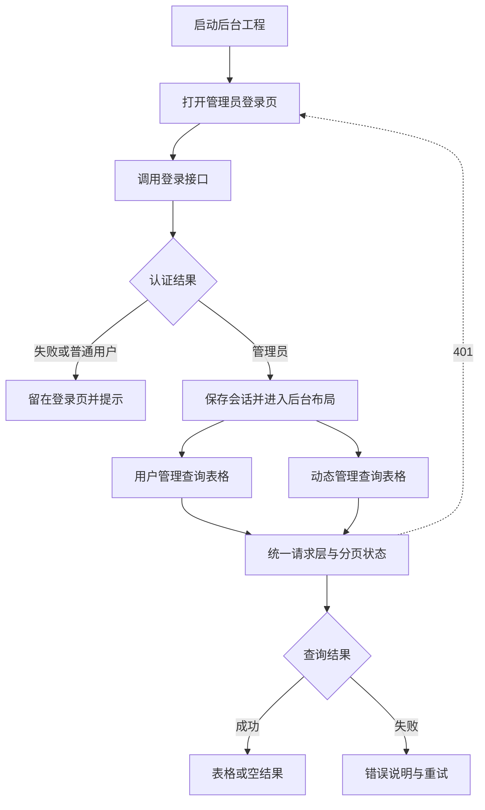

# 软件工程大作业 M08 第一周后台实现说明

> 项目：多媒体朋友圈展示系统 · 负责人：叶天豪（M08）
> 日期：2026 年 11 月 25 日 · 工作分支：`feat/m08-admin-week1`
> 基线：`main` / `8c399d44894e3bd922657f244b31ae1a1237513c`；第一周成果位于上述工作分支。
> 实现状态：第一周前端工程、登录与查询功能已落地；真实服务端联调、同伴验收和浏览器视觉检查尚未完成。

第一周后台已实现管理员登录、路由布局、用户基础查询和动态组合查询。两个表格共用分页和请求反馈，显示加载、空结果、失败与重试。页面通过统一 API 请求服务端，数据库读写和真实权限校验仍由 Spring Boot 完成。运行配置、待确认字段和最终部署示例见 [后台 README](/Users/yth/yth_szu/软件工程/大作业/exp_5/src/admin-web/README.md)。

## 1. 怎么做



**主线：**登录管理员 → 进入用户或动态页面 → 提交查询条件 → 获取服务端分页 → 显示记录或明确反馈。

- **运行：**Node.js 22.12+，`npm ci` 后使用 `npm run dev` 调用真实 API；`npm run dev:demo` 为显式虚构样例演示。生产构建不装配演示请求。机器上 Node.js 22.23.1 已用于验证，无需修改默认系统 Node。
- **代码：**按 aireader 规则区分 app 装配、modules 页面与业务逻辑、common 请求与共用组件；具名函数和类有中文头部注释。依赖固定版本和锁文件，ESLint、Prettier 与严格 TypeScript 检查一致。
- **权限：**登录角色为 `ADMIN` 才建立后台会话；刷新后复核 `/users/me`；无令牌不发管理请求，401 回登录，403 清空本页管理数据。服务端必须独立校验令牌、角色与用户状态。
- **查询：**草稿条件和已提交条件分开；筛选及页大小改变回第一页。日期按北京时间发送和展示；旧请求取消与版本检查防止晚到结果覆盖新结果。
- **本周边界：**删除或禁用、改密、媒体预览尚未实现。M01 主工程和用户完整样例待接入；已有前端自动化测试及构建结果见 [第一周证据](/Users/yth/yth_szu/软件工程/大作业/exp_5/tests/evidence/M08/week1/README.md)。

实际目录如下，保留各文件的主要职责，测试位于同工程 `tests/`：

```text
src/admin-web/
├── package.json / package-lock.json    npm 命令与固定依赖
├── vite.config.ts / vitest.config.ts   开发代理与测试配置
├── .env.example / .env.demo            真实服务样例与开发演示模式
├── eslint.config.js / .prettierrc.json  规范与格式检查
├── README.md                          运行和部署交接
└── src/
    ├── main.ts / App.vue               挂载组件、中文组件配置与路由出口
    ├── app/services.ts                 请求、认证及演示入口装配
    ├── app/router.ts                   路由与身份复核守卫
    ├── app/AdminLayout.vue             导航、账号与退出入口
    ├── modules/auth/logic/authState.ts  会话状态、登录与恢复
    ├── modules/auth/pages/LoginPage.vue 登录表单与重试
    ├── modules/users/pages/UsersPage.vue 用户关键词表格
    ├── modules/posts/pages/PostsPage.vue 动态组合筛选表格
    ├── common/data/models.ts           跨页面业务类型
    ├── common/data/http.ts             请求、响应信封与 API 错误
    ├── common/data/adminApi.ts         四个端点与网络对象校验
    ├── common/logic/query.ts           筛选校验及北京时间格式化
    ├── common/logic/usePagedQuery.ts   分页、取消与状态一致性
    ├── common/components/ListPanel.vue 加载、空结果、错误与分页
    ├── common/components/StatusPage.vue 无权限和 404 页面
    ├── demo/demoFetch.ts               显式演示请求与虚构数据
    └── styles/main.css                 布局、主题与窄屏适配
```

## 2. 函数调用链

### 2.1 打开受保护路由 → 验证后显示管理页面

入口：[路由守卫](/Users/yth/yth_szu/软件工程/大作业/exp_5/src/admin-web/src/app/router.ts:60)。状态装配：[services.ts](/Users/yth/yth_szu/软件工程/大作业/exp_5/src/admin-web/src/app/services.ts:11)。身份复核：[ensureSession](/Users/yth/yth_szu/软件工程/大作业/exp_5/src/admin-web/src/modules/auth/logic/authState.ts:140)。

```text
浏览器进入 /users 或 /posts
→ router.beforeEach(to)
  → auth.ensureSession()
    → getRequestSession()
      ├─ 无会话或本地过期：返回 false；过期先 clearSession()
      └─ 有会话：
         ├─ 本次身份已验证：返回 true
         ├─ 身份验证正在进行：等待共享 Promise
         └─ 刷新恢复后的首次验证：api.getMe(signal)
            → http.request('/users/me') → HTTP 请求交接

本人信息返回 ensureSession 后：
├─ 响应属于旧会话、被取消或期间过期：返回 false
├─ 非管理员、禁用、401 或 403：清会话，返回 false
├─ 网络或格式异常：向守卫抛错，登录页显示验证失败与重试
└─ 有效管理员：更新 user 并标记已复核，返回 true

守卫接收结果：
├─ true：挂载 AdminLayout 与对应子页面
└─ false：跳转 /login，并保存允许的 returnTo
```

公开的 `/login`、`/403` 和 404 路由不挂载管理表格；登录目标只允许 `/users`、`/posts`，避免外部地址进入跳转流程。

### 2.2 提交登录表单 → 建立管理员会话

入口：[LoginPage](/Users/yth/yth_szu/软件工程/大作业/exp_5/src/admin-web/src/modules/auth/pages/LoginPage.vue:29)。关键操作：[认证 login](/Users/yth/yth_szu/软件工程/大作业/exp_5/src/admin-web/src/modules/auth/logic/authState.ts:103)、[API login](/Users/yth/yth_szu/软件工程/大作业/exp_5/src/admin-web/src/common/data/adminApi.ts:167)。

```text
点击登录 / 表单回车 → submitLogin()
├─ 正在提交：不重复发送
├─ 账号或密码为空：显示必填提示
└─ 有输入：auth.login(account, password)
   → clearSession() → 新登录版本与 AbortController
   → api.login(trim 后账号, 原始密码, signal)
     → http.request('/auth/login', public=true)
       → 不附加旧令牌 → 发送账号密码 → 解析响应

响应返回 auth.login 后：
├─ 登录已取消或版本变化：拒绝旧结果
├─ USER / DISABLED：抛出无后台权限提示，不持久保存会话
├─ 有效期已过：拒绝失效凭证
└─ ADMIN：保存内存会话与 sessionStorage，标记已验证

submitLogin 成功后：清空密码 → router.replace(合法 returnTo)
失败：登录页显示具体原因；finally 解除提交状态
```

真实密码检查和 JWT 签名验证属于 M01 服务端；前端不解析未经验证的 JWT 来授予权限。演示模式使用相同前端流程，响应由独立的 demoFetch 提供。

### 2.3 提交用户或动态筛选 → 显示服务端当前页

入口：[用户 searchUsers](/Users/yth/yth_szu/软件工程/大作业/exp_5/src/admin-web/src/modules/users/pages/UsersPage.vue:21)、[动态 searchPosts](/Users/yth/yth_szu/软件工程/大作业/exp_5/src/admin-web/src/modules/posts/pages/PostsPage.vue:29)。请求：[listUsers / listPosts](/Users/yth/yth_szu/软件工程/大作业/exp_5/src/admin-web/src/common/data/adminApi.ts:205)。

```text
页面挂载 → list.runQuery(初始 page=1, pageSize=10)

用户页点击查询 → searchUsers()
→ buildUserQuery(keyword 草稿, page=1, 已选 pageSize)
→ list.runQuery(nextQuery)
  → api.listUsers(query, signal)
    → http.request('/admin/users', query, signal)

动态页点击查询 → searchPosts()
→ buildPostQuery(filters 草稿, page=1, 已选 pageSize)
  ├─ 作者、日期或 Unicode 长度无效：本页提示，不发请求
  └─ 合法：省略空字段，日期保留 YYYY-MM-DD
→ list.runQuery(nextQuery)
  → api.listPosts(query, signal)
    → http.request('/admin/posts', query, signal)

API 结果返回后 → readPage() 核对页码、条数、总数并解析每项
→ list 接受最新有效结果
→ ListPanel 展示表格 / 成功零条的空结果 / 错误与重试
```

动态接口对齐现有 [PostController.adminList](/Users/yth/yth_szu/软件工程/大作业/exp_5/src/backend/modules/posts/src/main/java/edu/szu/moments/posts/PostController.java:58)，用户列表字段仍待 M01 确认；不存在的响应字段不会被包装成假成功。

### 2.4 翻页或连续查询 → 保持条件和最新结果一致

关键实现：[runQuery](/Users/yth/yth_szu/软件工程/大作业/exp_5/src/admin-web/src/common/logic/usePagedQuery.ts:39)、[分页操作](/Users/yth/yth_szu/软件工程/大作业/exp_5/src/admin-web/src/common/logic/usePagedQuery.ts:75)。

```text
runQuery(nextQuery)
→ cancelQuery()：递增 requestId 并取消前一个请求
→ 保存已提交条件，捕获 requestId 与 sessionVersion
→ 设置 loading，清除本次错误 → 等待 loadPage()

响应或异常返回后：
├─ requestId 或 sessionVersion 变化：忽略旧结果
├─ 主动取消：不显示请求失败
├─ 成功：更新分页结果
├─ 401 / 403：清空本页管理数据
└─ 其他失败：保留上次成功结果，并显示“当前为上次查询结果”

finally 只有当前请求结束 loading

翻页 → changePage(page) → 保留已提交条件 runQuery()
改页大小 → changePageSize(size) → page=1 后 runQuery()
重试 → runQuery() → 重用已提交条件
组件离开 / 会话版本变化 → cancelQuery()，旧响应不能恢复结果
```

查询输入草稿不直接进入翻页请求。失败时暂停旧分页控件，避免已显示的旧页码与正在生效的查询条件混淆。

### 2.5 服务端返回 401 或点击退出 → 清理管理会话

请求处理：[http.ts](/Users/yth/yth_szu/软件工程/大作业/exp_5/src/admin-web/src/common/data/http.ts:65)。清理：[clearSession](/Users/yth/yth_szu/软件工程/大作业/exp_5/src/admin-web/src/modules/auth/logic/authState.ts:28)。

```text
受保护请求返回 HTTP 401
→ request() 调用 onUnauthorized(发起请求的版本)
→ auth.expireSession(requestVersion)
  ├─ 是旧会话请求：不撤销后来建立的新会话
  └─ 当前会话：clearSession('登录已失效，请重新登录')
     → 递增会话版本，取消认证，移除 sessionStorage
     → 查询状态监听版本：取消在途查询，清空列表
     → 路由监听 hasSession：回 /login

管理员点击退出 → AdminLayout.logout()
→ auth.clearSession() → router.replace('/login')
```

401 即使响应体不是 JSON 也先通知认证失效；403 表示无权限，不一律作为令牌过期。退出只清本标签页会话，服务端撤销令牌需要后续接口约定。
