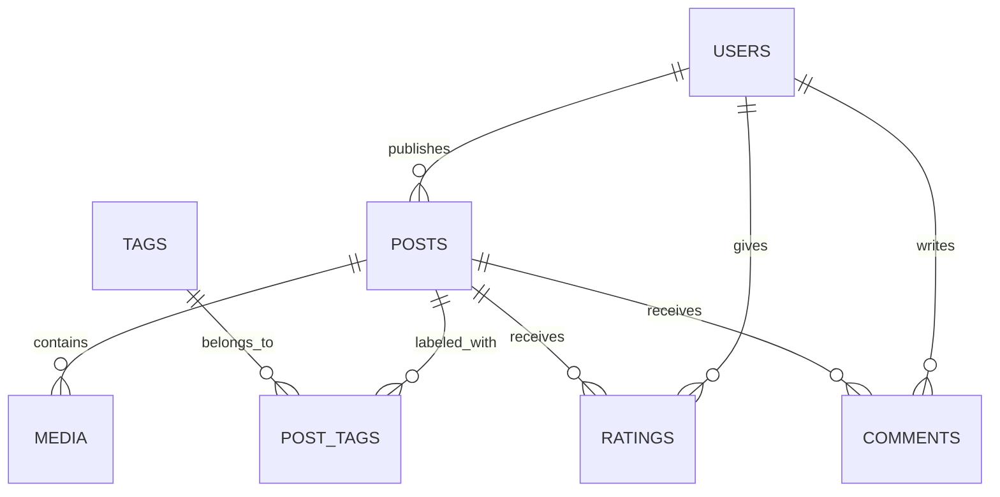

# 数据模型约定 v1

本文件定义数据库实体和约束；可执行结构由 `src/backend/` 中的 Flyway 迁移文件维护。

M02 已提供 `posts`、`tags`、`post_tags` 的候选迁移，位置为 `src/backend/modules/posts/src/main/resources/db/migration-candidates/m02/posts.sql`（相对项目根目录）。正式版本号由 M01 在合入前登记；模块测试的 V1/V2 顺序仅用于独立测试库，不是全组正式版本号。动态模块使用 UTC `DATETIME(6)`，正文上限 10000 个 Unicode 码点，标签采用区分大小写的 `utf8mb4_0900_bin`；具体交接见 [M02 实施约定](posts-module.md)。

## 核心实体

| 实体 / 表名 | 关键字段 | 关系和约束 |
| --- | --- | --- |
| 用户 `users` | `id`、`account`、`password_hash`、`nickname`、`role`、`status`、`token_version`、`created_at` | `account` 唯一；密码只存 BCrypt 哈希；`role` 为 USER 或 ADMIN，`status` 为 ACTIVE 或 DISABLED |
| 动态 `posts` | `id`、`author_id`、`text`、`status`、`created_at`、`updated_at` | 多对一关联用户；作者身份由服务端写入；`status` 为 ACTIVE 或 DELETED |
| 媒体 `media` | `id`、`post_id`、`uploaded_by`、`type`、`storage_key`、`status`、`sort_order`、`created_at` | 一条动态对应零到多个媒体；上传时 `post_id` 为空、`status` 为 PENDING，绑定动态后为 ACTIVE |
| 标签 `tags` | `id`、`name` | 标签名唯一；保存前去除首尾空格，长度 1–20 字符 |
| 动态标签 `post_tags` | `post_id`、`tag_id` | 复合唯一键，防止同一动态重复挂同一标签 |
| 评分 `ratings` | `id`、`post_id`、`user_id`、`score`、`created_at`、`updated_at` | `post_id + user_id` 唯一；分值 1–5 的整数，再次评分更新原记录 |
| 评论 `comments` | `id`、`post_id`、`user_id`、`content`、`status`、`created_at` | 评论关联用户和动态；只支持一级评论，长度 1–500 字符 |
| 管理操作 `admin_operation_logs` | `id`、`admin_id`、`action`、`target_type`、`target_id`、`created_at` | 记录管理员删除用户或动态的行为 |

管理员使用同一张 `users` 表，角色为 ADMIN；初始化脚本从环境变量读取初始密码后创建管理员账号。

## 关系图

## 数据和查询约束

- `posts(author_id, created_at)` 支持“我的动态”；`posts(created_at, id)` 支持时间倒序和分页。
- `post_tags(tag_id, post_id)` 支持按标签检索；日期范围使用动态的 `created_at`，按北京时间自然日包含起止日期。
- `ratings(post_id, user_id)` 唯一，平均分由有效评分记录计算并四舍五入到 1 位小数；无评分时返回 `null`、人数为 0。
- 删除动态时把 `posts.status` 设为 DELETED；动态列表、详情、评论和媒体读取均不返回已删除动态的内容。
- 删除用户时把 `users.status` 设为 DISABLED，其发布的动态设为 DELETED，其评论设为 DELETED，移除其发出的评分，`token_version` 加 1。
- 媒体访问地址由服务端生成，数据库保存存储标识；不要把用户原始文件名直接当作存储键。
- 媒体只能绑定上传者自己创建的动态，且每个媒体仅绑定一条动态。未绑定 24 小时的媒体记录与文件由清理任务移除。

## 数据库迁移规则

每次改表新增一个 Flyway 迁移文件，文件名使用 `V序号__说明.sql`。不要直接修改已被组员使用的旧迁移文件；需要变更时创建新版本并同步本文件。
